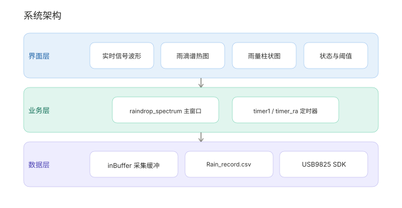
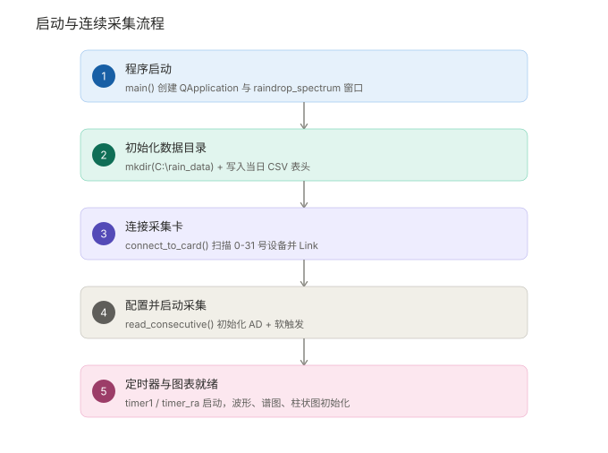
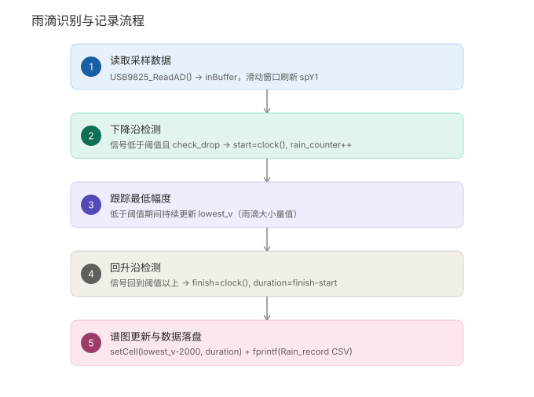
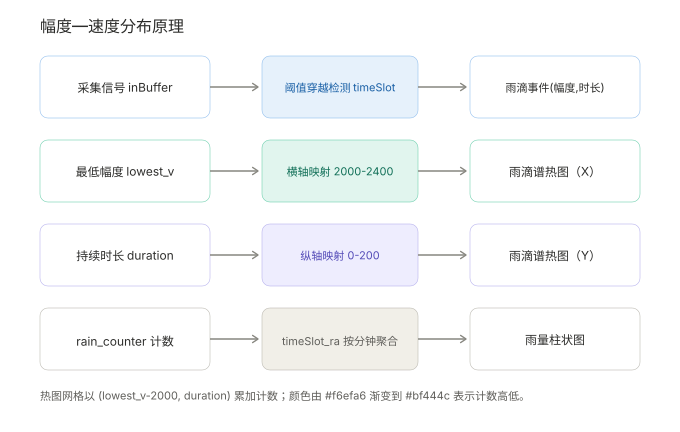

# 系统架构与关键流程

## 1. 系统架构

软件分为界面层、业务层与数据层三层，采集卡硬件通过 SDK 接入业务层。



| 层次 | 组成 | 职责 |
|------|------|------|
| 界面层 | `raindrop_spectrum.ui`、`QChartView`（`widget_signal` / `widget_3`）、`QCustomPlot`（`widget_spectrum`）、按钮与标签 | 实时波形、雨滴谱热图、每分钟雨量柱状图、状态标签与鼠标读数 |
| 业务层 | `raindrop_spectrum` 主窗口、`timer1` / `timer_ra`、`timeSlot()` / `timeSlot_ra()` | 设备连接、AD 配置、雨滴识别、阈值更新、谱图与统计刷新 |
| 数据层 | `inBuffer` 采集缓冲、`C:\rain_data\Rain_record*.csv`、`USB9825.h/.lib` | 采样数据暂存、雨滴事件落盘、采集卡 SDK 接口 |

**数据流**：USB9825 采集卡 → `USB9825_ReadAD()` → `inBuffer` → 阈值穿越检测（`timeSlot()`）→ `spY1` 波形 / `colorMap` 雨滴谱（`setCell`）/`rain_counter` 计数 → `timeSlot_ra()` 按分钟聚合 → `QBarSeries` 柱状图；同时 `fprintf()` → 当日 CSV。

## 2. 关键流程一：启动与连续采集



1. `main()` 创建 `QApplication` 与 `raindrop_spectrum` 窗口并 `show()`；
2. 构造函数 `mkdir("C:\rain_data")`、写入当日 CSV 表头，随后自动调用 `connect_to_card()` 扫描设备；
3. `read_consecutive()` 用 `USB9825_PARA_INIT` 初始化 AD 并软触发启动，创建波形图表与 `QBarSet` / `QBarSeries`；
4. 启动 `timer1`（约 0.1 ms，雨滴识别）与 `timer_ra`（1000 ms，分钟统计），初始化 `QCPColorMap` 谱图；
5. 界面按钮连接槽函数：连接/开始采集/暂停采集，以及阈值 `spinBox_3` 的 `valueChanged()`。

## 3. 关键流程二：雨滴识别与记录



1. `timeSlot()` 调用 `USB9825_ReadAD()` 将采样写入 `inBuffer`，并维护 200 点滑动窗口 `vec_sg` 刷新波形 `spY1`；
2. 当 `inBuffer[index] < background_sg` 且 `check_drop == true`：记录 `start = clock()`，`lowest_v = 2500`，`rain_counter++`，置 `check_drop = false`；
3. 信号低于阈值期间持续取 `lowest_v` 最小值；
4. 当 `inBuffer[index] >= background_sg` 且 `check_drop == false`：`finish = clock()`，`duration = finish - start`，置 `check_drop = true`；
5. 谱图在 `(lowest_v - 2000, duration)` 网格 `setCell(..., 1)` 并 `replot()`；
6. 以 `fprintf()` 向 `C:\rain_data\Rain_recordYYYY-MM-DD.csv` 追加一行时间戳、`lowest_v`、`duration`。

## 4. 幅度—速度分布原理



雨滴谱热图以信号幅度（2000–2400）为横轴、雨滴速度（0–200）为纵轴，每个网格单元累加落入该区间的雨滴事件数，颜色由浅（`#f6efa6`）到深（`#bf444c`）表示计数高低。幅度取自雨滴信号的最低电压 `lowest_v`，速度取自信号持续时长 `duration`。柱状图则以分钟为窗口对 `rain_counter` 聚合，反映雨强的时序变化。二者共享同一份识别结果，分别刻画「尺度—速度分布」与「雨量—时间变化」。

## 5. 时序关系

```text
main ──> show() ──> 构造函数 ──> connect_to_card() ──> read_consecutive()
                                                          │
                              ┌───────────────────────────┼────────────────────────────┐
                              ▼                           ▼                            ▼
                        timer1: timeSlot()           timer_ra: timeSlot_ra()      QCPColorMap 谱图
                        波形 + 雨滴识别                 分钟雨量聚合                  (setCell/replot)
                              │                           │
                   ┌──────────┴──────────┐         show_rain_amount()
                   ▼                     ▼               柱状图
            spY1 波形刷新        CSV 落盘 + 谱图累积
```

- `timer1` 与 `timer_ra` 为独立 `QTimer`，分别驱动雨滴识别与按分钟聚合；
- 主线程通过 `qApp->processEvents()` 在采集与识别间隙保持界面响应（见源码）。
